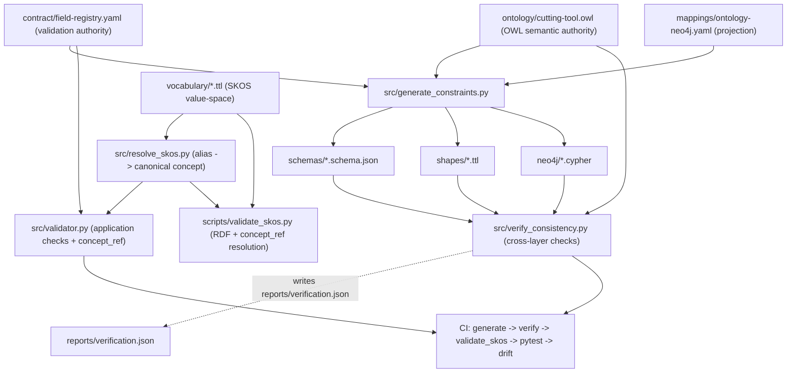
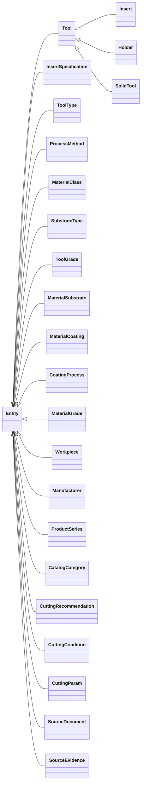
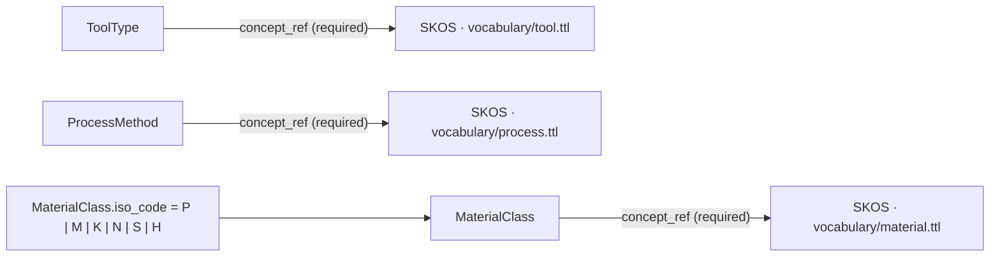
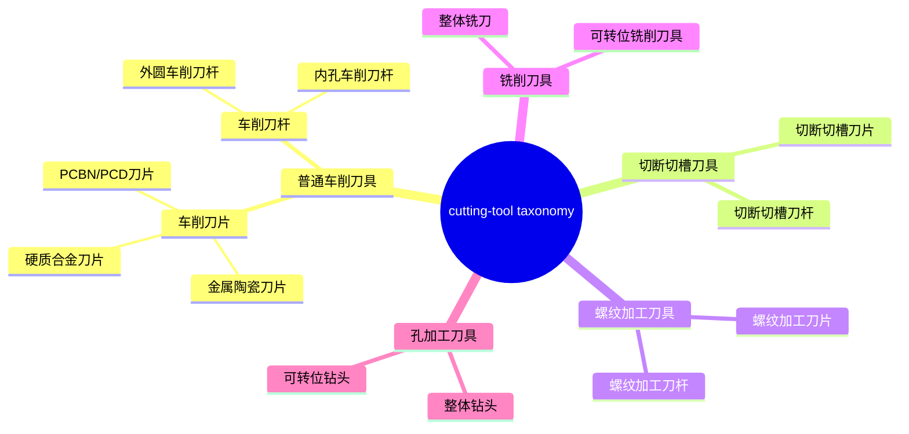
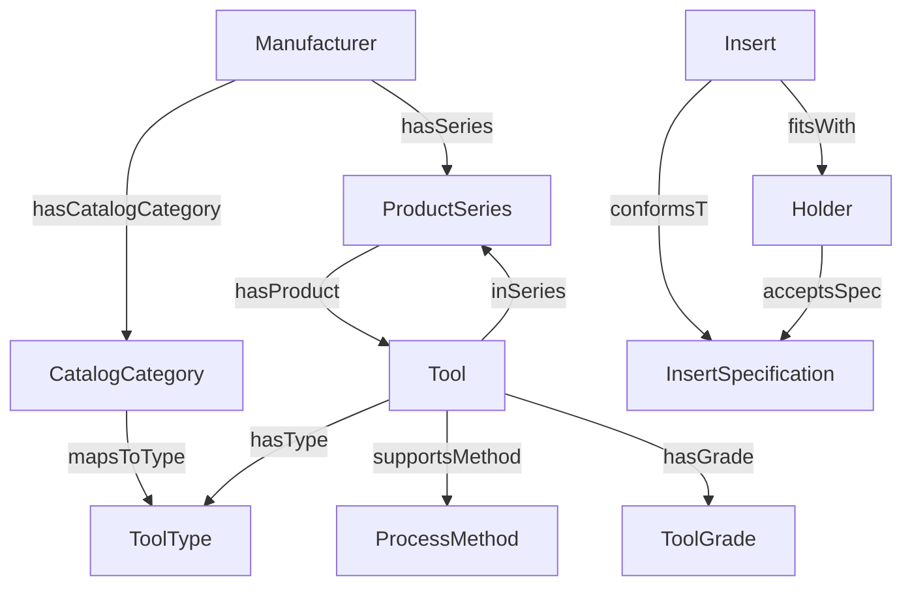
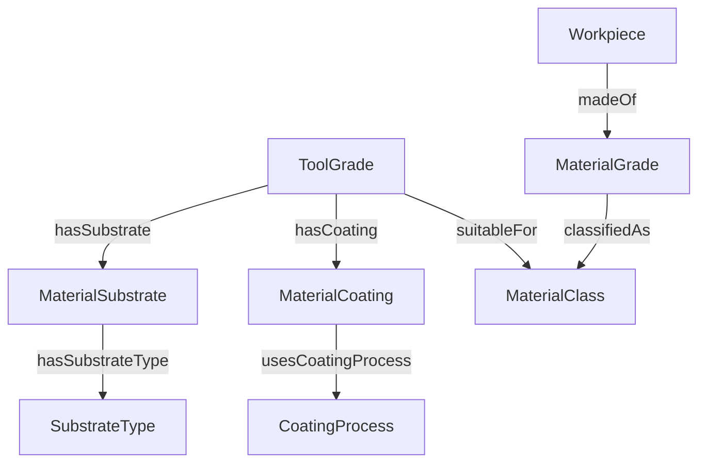
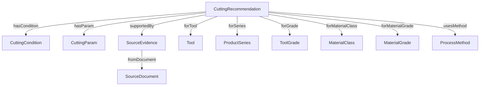
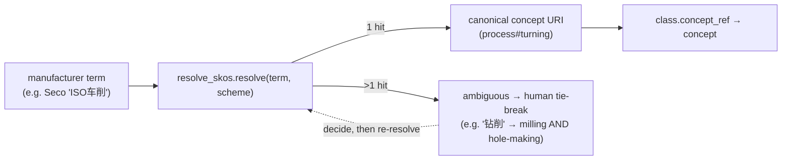

# Industrial Cutting Tool Ontology

**An ontology-driven, validation-first foundation for coherent cutting-tool knowledge graphs — one semantic framework for every manufacturer's catalog data.**


[简体中文](README.zh-CN.md) | **English**

> **Project status:** v1.4 engineering baseline. The generators and offline validations are implemented; this is **not a production-ready tooling-recommendation system**, and no live Neo4j deployment or full OWL DL reasoning run is claimed.

## Why this project exists

Industrial catalogs speak different dialects — the same concept is "ISO车削" to one maker and "普通车削" to another. This project grew out of master's research on property-graph schema design and became an open, standardized way to represent and align heterogeneous cutting-tool data from any manufacturer: a semantic foundation that data-hungry systems (including AI) can rely on. The full origin story is preserved in [`docs/origin.md`](docs/origin.md).

## Table of Contents

- [Why this project exists](#why-this-project-exists)
- [Overview](#overview)
- [Tech stack](#tech-stack)
- [Architecture and sources of authority](#architecture-and-sources-of-authority)
- [Domain model](#domain-model)
- [Graph model](#graph-model)
- [Requirements](#requirements)
- [Quick start](#quick-start)
- [Using a schema and validating data](#using-a-schema-and-validating-data)
- [Project layout](#project-layout)
- [Current verification baseline](#current-verification-baseline)
- [Roadmap](#roadmap)
- [Maintaining and extending the schema](#maintaining-and-extending-the-schema)
- [Data provenance and safety](#data-provenance-and-safety)
- [Contributing](#contributing)
- [Security](#security)
- [Background & acknowledgments](#background--acknowledgments)
- [Acknowledgment of standards](#acknowledgment-of-standards)

## Overview

Industrial cutting-tool catalogs use heterogeneous terminology and structures for inserts, holders, solid tools, tool grades, workpiece materials, machining methods, and recommended cutting parameters. This project establishes a common semantic vocabulary and machine-readable contracts to reduce schema drift across RDF data, JSON interfaces, and a Neo4j property-graph projection.

**What it does**

- Models domain classes and object/data properties in **OWL 2**.
- Maintains controlled classification vocabularies in **SKOS** (five taxonomy trees: cutting tools, machining processes, materials, manufacturers, and cutting parameters), rather than treating every domain taxonomy term as an OWL class. `skos:altLabel` records cross-manufacturer naming variants (e.g. `ISO车削` for `普通车削加工`).
- Treats the controlled vocabulary as the **enforceable value-space** of the closed-world classes: `ToolType` / `ProcessMethod` / `MaterialClass` carry a required `concept_ref` pointing at a real concept in their bound scheme. `src/resolve_skos.py` resolves manufacturer aliases to canonical concept URIs and surfaces cross-scheme ambiguity for human review rather than guessing.
- Uses a controlled **field registry** to generate JSON Schema, SHACL field constraints, and Neo4j Cypher constraint scripts.
- Runs offline checks for OWL vocabulary alignment, JSON validity, SHACL positive/negative fixtures, documented model identifiers, and projected constraint coverage.
- Records verification results in a machine-readable report.

**Out of scope in this release:** full catalog ingestion, vendor-independent product property verification, engineering-grade cutting recommendations, live-database deployment, and complete OWL DL consistency proofs.

## Tech stack

| Concern | Technology |
| --- | --- |
| Semantic model | **OWL 2** (`ontology/cutting-tool.owl`) |
| Controlled vocabulary | **SKOS** (`vocabulary/*.ttl`, 5 taxonomies, 136 concepts) |
| RDF data validation | **SHACL** (`shapes/generated-shapes.ttl`, `shapes/relation-shapes.ttl`) |
| Data-exchange contract | **JSON Schema Draft 2020-12** (`schemas/`) |
| Graph projection | **Neo4j Cypher** constraints (`neo4j/`) |
| Constraint contract / source of truth | **YAML** field registry + mapping (`contract/`, `mappings/`) |
| Runtime | **Python 3.10+** (`rdflib`, `pyshacl`, `jsonschema`, `PyYAML`) |
| Pipeline & CI | `generate_constraints` → `verify_consistency` → `validate_skos` → `pytest`, GitHub Actions |

## Architecture and sources of authority

| Layer | Role | Location |
| --- | --- | --- |
| OWL | Semantic definitions, class taxonomy and property meaning | `ontology/cutting-tool.owl` |
| SKOS | Controlled classification vocabulary | `vocabulary/` |
| Field contract | Required fields, types, ranges, patterns, enums | `contract/field-registry.yaml` |
| Mapping | Field/property labels and graph projection conventions | `mappings/ontology-neo4j.yaml` |
| SHACL | Generated RDF data-shape checks | `shapes/generated-shapes.ttl` |
| JSON Schema | Generated JSON object validation | `schemas/` |
| Neo4j | Generated Community uniqueness / Enterprise existence constraints | `neo4j/` |

The OWL ontology is the **semantic authority**, while the registry is the **validation-rule authority**. They are aligned by mapping and cross-layer tests. OWL's open-world semantics must not be mistaken for a closed-world input validator. Neither SHACL nor database constraints fully replace application-level business validation.

**Generation pipeline:**



## Domain model

The baseline covers 24 modeled entity classes, including:

- **Products:** `Tool`, `Insert`, `Holder`, `SolidTool`, `InsertSpecification`
- **Materials:** `ToolGrade`, `MaterialSubstrate`, `MaterialCoating`, `MaterialGrade`, `Workpiece`
- **Classification:** `ToolType`, `ProcessMethod`, `MaterialClass`, `SubstrateType`
- **Catalogs:** `Manufacturer`, `ProductSeries`, `CatalogCategory`
- **Recommendations and evidence:** `CuttingRecommendation`, `CuttingCondition`, `CuttingParam`, `SourceDocument`, `SourceEvidence`

Example use cases: cross-catalog lookup, tool-grade-to-material matching candidates, verified insert/holder compatibility, constraint-aware cutting-parameter records, and evidence traceability. **Candidate compatibility is not a verified fit, and a record is not operational machining advice.**

**OWL class hierarchy** (every concrete class is an `Entity`):



**Controlled vocabulary is the value-space** of the closed-world classes — `ToolType`, `ProcessMethod` and `MaterialClass` carry a required `concept_ref` anchored to a real concept in their bound scheme:



The five SKOS taxonomies are trees (representative: cutting-tool taxonomy):



## Graph model

The Neo4j projection renders every entity class as a node and every registered relationship as an edge. Concrete tool labels `Insert`/`Holder`/`SolidTool` are separate Neo4j labels rather than `Tool` sub-edges; the relationship graph is split into three semantic clusters for readability.







## Requirements

- Python 3.10+ (recommended)
- See [`requirements.txt`](requirements.txt) for all Python dependencies.
- A Neo4j server is **not** needed for offline generation and verification. Live database use requires a separately provisioned compatible server and permissions.

## Quick start

From the repository root:

```bash
python -m venv .venv
```

Activate the environment on macOS/Linux:

```bash
source .venv/bin/activate
```

On Windows PowerShell:

```powershell
.venv\Scripts\Activate.ps1
```

Install dependencies and run checks:

```bash
python -m pip install -r requirements.txt
python -m src.generate_constraints
python -m src.verify_consistency
python -m scripts.validate_skos
python -m pytest tests/ -q
```

> `pytest` is a development/test dependency. If it is not installed, run `python -m pip install pytest` before the final command.

The generator updates `schemas/`, `shapes/generated-shapes.ttl`, and the two `neo4j/*constraints.cypher` files. The verifier writes `reports/verification.json`.

## Using a schema and validating data

You can validate a JSON instance, for example [`examples/Insert.json`](examples/Insert.json), against the generated Insert schema:

```python
import json
from pathlib import Path
from jsonschema import validate

schema = json.loads(Path('schemas/Insert.schema.json').read_text(encoding='utf-8'))
data = json.loads(Path('examples/Insert.json').read_text(encoding='utf-8'))
validate(instance=data, schema=schema)
print('Valid')
```

For RDF integrity checks, refer to `src/verify_consistency.py`, which invokes `pyshacl` with the generated Shacl shapes and the ontology graph. For cross-field recommendation checks (range ordering, recommended-speed bounds, `feed_type`/`feed_unit` consistency), see `src/validator.py`. Relationship-level integrity (evidence traceability, insert/holder mounting contract, in-range recommended speeds, unit consistency) is expressed as SHACL rules in `shapes/relation-shapes.ttl`; pass both generated and relation shapes to `pyshacl` for full closed-world enforcement.

The controlled classification vocabularies under `vocabulary/` are validated for RDF/SKOS well-formedness, and every `concept_ref` used by examples is resolved against them (an unresolved reference fails the check):

```bash
python -m scripts.validate_skos
```

**Normalizing manufacturer terms to canonical concepts:** the controlled vocabulary is the *value-space* of the closed-world classes, and `src/resolve_skos.py` maps any canonical label or manufacturer alias back to the stable concept URI. Terms that resolve to more than one concept are surfaced as ambiguity (e.g. `钻削` names both milling and hole-making; material's two distinct `硬质合金` branches) rather than guessed:

```bash
python -m src.resolve_skos --term "ISO车削"
# https://example.org/cutting-tool/vocabulary/process#turning
python -m src.resolve_skos --report   # full alias -> canonical ledger
```

To anchor a `ToolType` / `ProcessMethod` / `MaterialClass` instance to the vocabulary, set its required `concept_ref` to a concept URI in the class's bound scheme (`tool`, `process`, `material`). The application validator rejects any `concept_ref` that does not resolve inside that scheme.



**On `RecommendationRecord`:** this JSON schema is an *aggregate view* used for the recommendation-input contract (a `CuttingRecommendation` together with its `links` to other entities). It is intentionally **not** an OWL class and is therefore **absent from the field registry** — register new OWL entities in `contract/field-registry.yaml` and they are projected into `schemas/`, `shapes/`, and `neo4j/` automatically.

## End-to-end pilot (`pilot/`)

A small-batch proof that the architecture carries a real repository pipeline
`standardize → validate → project → load Neo4j → query`, reusing the existing
authority layers (OWL / SKOS / field registry / `ontology-neo4j.yaml`) and **without
modifying `src/`**. See [`pilot/README.md`](pilot/README.md). Verified outcome: a
12-node / 13-relationship subgraph validates, projects to deterministic Cypher,
loads into a local Docker Neo4j 5-community (`bolt://localhost:7689`), and answers
3/3 representative queries (series traversal, grade→material suitability,
evidence-backed recommendation chain). Pilot data are development fixtures, not
production product specifications.

```bash
bash pilot/run_neo4j.sh        # start local Neo4j (host ports 7475/7689)
python -m pilot.load_neo4j     # validate + load the toy subgraph (checks online invariants)
python -m pilot.query_neo4j    # run representative queries (expect ALL_QUERIES_PASS)
python -m pilot.verify_neo4j_rules   # online relationship rules from shapes/relation-shapes.ttl
```

The `relation-shapes.ttl` invariants (evidence traceability, mounting contract, unit
consistency, recommended-speed range) are mirrored as violation-detecting Cypher
checks in `pilot/neo4j_rules.py`, so the offline SHACL rules have an executable
equivalent on the live graph (`verify_neo4j_rules` exits non-zero on any violation).

The document-anchored fixture `examples/document-anchored-tool-identifiers.json` is a
contract-compliant, near-real ingestion sample: its non-contract fields are cleaned, and
its tool records are anchored through a `forTool → supportedBy → fromDocument`
provenance chain. It validates, projects, and loads into the same pipeline — see
`tests/test_document_identifiers.py`.

## Project layout

```text
ontology/        OWL ontology definition
vocabulary/      SKOS controlled vocabularies
pilot/           End-to-end subgraph pilot (optional, non-invasive)
contract/        Field specification and constraint source
mappings/        OWL / data / Neo4j naming and relation mapping
schemas/         Generated JSON Schemas
shapes/          Generated SHACL shapes
neo4j/           Generated Cypher constraint scripts
src/             Constraint generator and validators
examples/        JSON, RDF, and document-anchored identifier fixtures
tests/           Regression and negative test cases
reports/         Verification results
docs/            Design decisions, validation boundaries, and analysis
```

## Current verification baseline

The packaged v1.4 verification run reports **395 successful offline checks with zero failures**, covers **8 identifier records** selected from the underlying design examples, and passes **20 regression tests** across the JSON / SHACL / SKOS routes plus vocabulary-enforced semantic alignment. See [`reports/verification.json`](reports/verification.json) for the exact recorded results. These checks **do not establish product-specification accuracy** — the identifier examples reflect recorded strings, not independently verified manufacturer datasheets.

## Roadmap

Deliberately **not in scope** for this release, in rough priority order:

- **Production data & deployment.** Audited vendor catalog ingestion, live Neo4j DDL + Cypher transaction tests, and a persistent project-owned namespace (today the namespace is a placeholder).
- **Deeper validation.** Full OWL DL reasoner consistency proofs, richer structural SHACL rules, a `toolStatus` / `recommendationStatus` split, and more SHACL-SPARQL relationship rules.
- **Application integration.** GraphRAG / agent query examples, reusable query scaffolds, and vendor-specific machining-condition handling with load/performance evaluation.

The next milestone is vocabulary-driven catalog ingestion end-to-end: normalize a sampled real catalog into the schema, project it to Neo4j, and verify queries against it.

## Maintaining and extending the schema

1. Define or modify semantic classes/properties in `ontology/cutting-tool.owl`.
2. Revise the field obligations in `contract/field-registry.yaml` and name projections in `mappings/ontology-neo4j.yaml`.
3. Extend SKOS trees under `vocabulary/` for new taxonomy terms (add `skos:scopeNote` provenance for every cross-manufacturer `skos:altLabel`); add relationship-level rules to `shapes/relation-shapes.ttl` for new cross-node invariants.
4. Run the generator, the cross-layer verifier, and `python -m scripts.validate_skos`.
5. Add positive and negative fixtures for new fields, classes, and relationships; extend `tests/test_regression.py` and `tests/test_semantic_alignment.py` accordingly.
6. Review generated diffs before committing; perform supported Neo4j integration tests separately.

**Known semantic pitfall:** the shared `status` property must not acquire multiple `rdfs:domain` statements that imply unrelated classes. This version avoids that error; a future migration may use `toolStatus` and `recommendationStatus`.

**URI policy:** `https://example.org/` is a placeholder namespace. The single source of truth for it is `src/namespaces.py` (`ON_BASE` / `VOCAB_BASE`); every generated artifact (shapes, schemas, constraints), the generator, scripts, and tests derive from it. To adopt a persistent project-owned namespace, change the two constants **there**, run `python -m src.generate_constraints`, and re-run the full regression. Do not hand-edit `example.org` elsewhere.

## Data provenance and safety

Examples are development fixtures and symbolic identifiers, **not authenticated product recommendations**. Never infer actual performance, insert/holder fit, speed/feed/depth values, or equipment safety from the example dataset. Production ingestion should retain source publication, revision, page/table evidence, review status, measurement units, and applicability conditions.

## Contributing

See [CONTRIBUTING.md](CONTRIBUTING.md) for style, testing, review, and issue-reporting guidelines. Please do not add personal, student, university, or confidential company details to documentation, examples, commits, or issue attachments. Use anonymized test fixtures and source data that you are permitted to redistribute.

## Security

See [SECURITY.md](SECURITY.md). Please avoid disclosing secrets, customer data, internal catalog extracts, or operational credentials in public reports.

## Background & acknowledgments

This project began as research on property-graph schema design and was reworked over several years in industry into the ontology-driven foundation you see here. The full personal origin story — the research, the lessons, and the gratitude behind it — is preserved in [`docs/origin.md`](docs/origin.md). It is kept separate so the technical documentation stays concise; the ideas and the intent are part of the project regardless.

## Acknowledgment of standards

The project uses W3C OWL 2, SKOS and SHACL conventions, JSON Schema Draft 2020-12, and Neo4j Cypher concepts. These references describe technical interoperability and do not imply endorsement.
