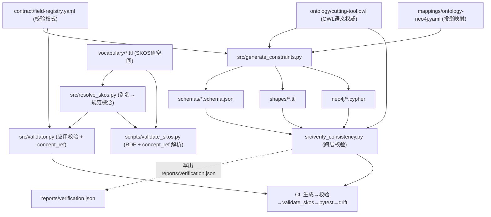
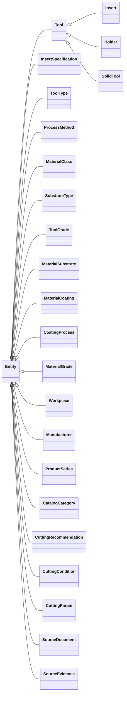
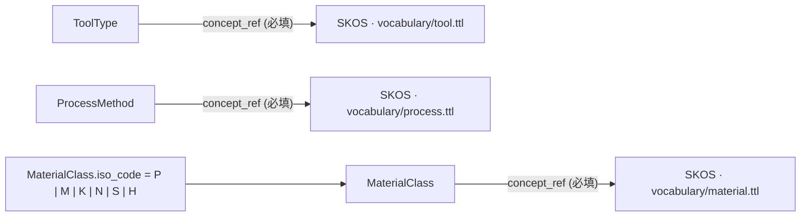
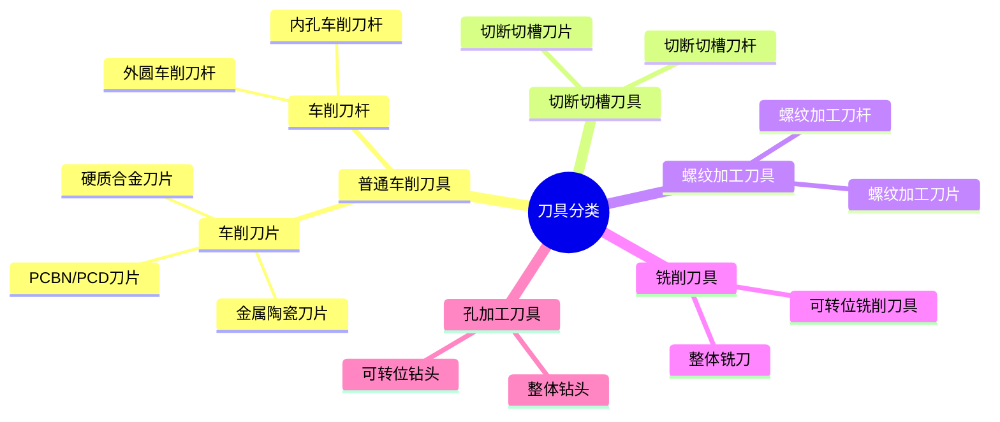
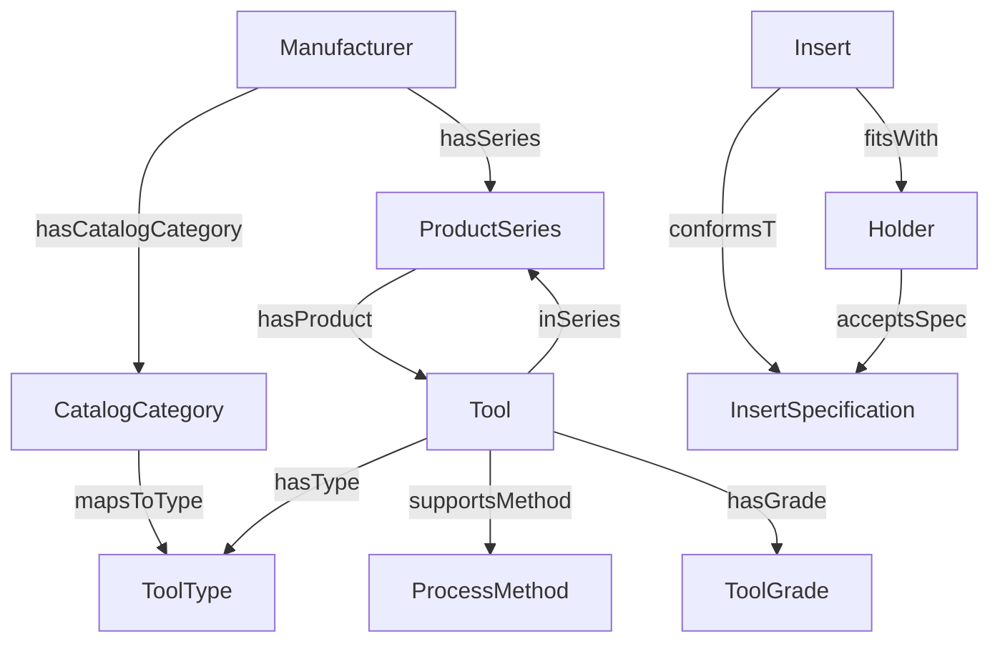
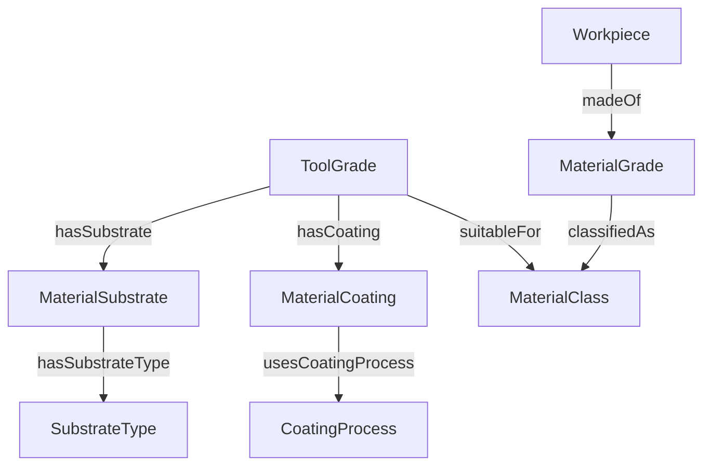
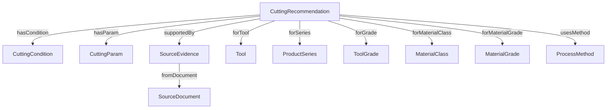
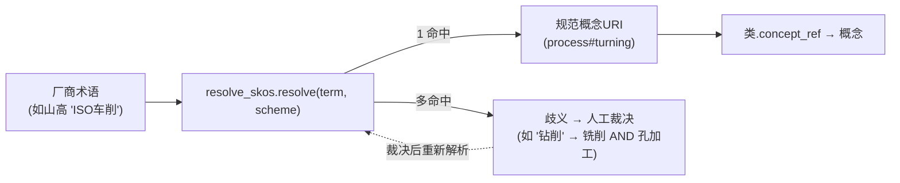

# 工业刀具知识图谱本体

**面向工业刀具的本体驱动、约束优先的知识图谱工程基础——用同一套语义框架，统一管理各家厂商的目录数据。**


**简体中文** | [English](README.md)

> **项目状态：** v1.4 研究与工程验证基线。约束生成器和离线测试已实现，但尚未达到生产级刀具推荐平台要求

## 为什么会有这个项目

工业目录说的是各自的方言——同一个概念，一家叫"ISO车削"，另一家叫"普通车削"。这个项目源于研究生阶段关于属性图 Schema 设计的研究，后经多年工业实践重构成一套开放、标准化的方式，去表示与对齐任何厂商的异构刀具数据：一个 AI 等数据驱动、语义敏感的系统可以依赖的语义底座。完整缘起见 [`docs/origin.md`](docs/origin.md)。

## 目录

- [为什么会有这个项目](#为什么会有这个项目)
- [项目简介](#项目简介)
- [技术栈](#技术栈)
- [架构与规范权威](#架构与规范权威)
- [领域范围与应用场景](#领域范围与应用场景)
- [图模型](#图模型)
- [环境要求](#环境要求)
- [快速开始](#快速开始)
- [JSON数据校验示例](#json数据校验示例)
- [项目目录](#项目目录)
- [测试结果与验证边界](#测试结果与验证边界)
- [路线图](#路线图)
- [二次开发与模型变更流程](#二次开发与模型变更流程)
- [数据溯源与安全使用](#数据溯源与安全使用)
- [贡献与安全](#贡献与安全)
- [背景与致谢](#背景与致谢)
- [标准说明](#标准说明)

## 项目简介

不同刀具厂商的产品目录在刀片、刀杆、整体刀具、材料牌号、工件材料、加工方式和切削参数等方面存在命名和结构差异。本项目通过统一语义本体、术语分类和结构化约束，减少RDF、JSON与Neo4j属性图之间的定义漂移。

**主要能力**

- 采用 **OWL 2** 定义领域类、继承关系及对象/数据属性。
- 使用 **SKOS** 管理行业分类与术语，不将所有分类词汇误当作OWL类。
- 将受控词表作为**封闭世界类的可执行值空间**：`ToolType`/`ProcessMethod`/`MaterialClass` 携带必填的 `concept_ref`，指向其在绑定词表中的真实概念；`src/resolve_skos.py` 将厂商别名归一化为规范概念URI，并把跨词表/跨分支歧义显式暴露，供人工复核而绝不擅自猜测。
- 基于统一**字段约束注册表**生成JSON Schema、SHACL约束和Neo4j Cypher约束。
- 实施OWL词汇对应关系、JSON合法性、SHACL正反例、型号标识以及生成结果覆盖率的离线测试。
- 输出可复查的机器可读验证报告。

**当前不包含：** 完整厂商目录数据导入、产品规格独立核验、可直接用于加工现场的参数推荐、实际数据库部署以及完整OWL DL一致性证明。

## 技术栈

| 关注点 | 技术 |
| --- | --- |
| 语义模型 | **OWL 2**（`ontology/cutting-tool.owl`） |
| 受控词表 | **SKOS**（`vocabulary/*.ttl`，5 棵分类树，136 个概念） |
| RDF 数据校验 | **SHACL**（`shapes/generated-shapes.ttl`、`shapes/relation-shapes.ttl`） |
| 数据交换契约 | **JSON Schema Draft 2020-12**（`schemas/`） |
| 图投影 | **Neo4j Cypher** 约束（`neo4j/`） |
| 约束契约 / 权威源 | **YAML** 字段注册表 + 映射（`contract/`、`mappings/`） |
| 运行环境 | **Python 3.10+**（`rdflib`、`pyshacl`、`jsonschema`、`PyYAML`） |
| 管线与 CI | `generate_constraints` → `verify_consistency` → `validate_skos` → `pytest`，GitHub Actions |

## 架构与规范权威

| 层次 | 主要职责 | 文件位置 |
| --- | --- | --- |
| OWL | 规范实体类型和语义关系 | `ontology/cutting-tool.owl` |
| SKOS | 维护分类体系与标准术语 | `vocabulary/` |
| 字段约束 | 必填规则、数值范围、枚举和数据类型 | `contract/field-registry.yaml` |
| 映射配置 | OWL属性、JSON字段和Neo4j投影映射 | `mappings/ontology-neo4j.yaml` |
| SHACL | 对RDF图数据执行结构和数据质量校验 | `shapes/generated-shapes.ttl` |
| JSON Schema | 数据接口及JSON实例验证 | `schemas/` |
| Neo4j | 唯一性约束和特定版本的存在性约束 | `neo4j/` |

**OWL是语义定义的权威来源；字段注册表是可执行数据校验规则的权威来源。** 两者借助映射和一致性测试保持同步。OWL采用开放世界语义，不能直接替代必填字段校验；SHACL及Neo4j约束也不能取代全部业务规则检查。

**约束生成管线：**



## 领域范围与应用场景

系统涵盖24个模型类，包括：

- **刀具产品：** `Tool`、`Insert`、`Holder`、`SolidTool`、`InsertSpecification`
- **刀具与工件材料：** `ToolGrade`、`MaterialSubstrate`、`MaterialCoating`、`MaterialGrade`、`Workpiece`
- **标准分类：** `ToolType`、`ProcessMethod`、`MaterialClass`、`SubstrateType`
- **产品目录：** `Manufacturer`、`ProductSeries`、`CatalogCategory`
- **加工推荐及来源：** `CuttingRecommendation`、`CuttingCondition`、`CuttingParam`、`SourceDocument`、`SourceEvidence`

典型应用包括跨厂商产品检索、刀具牌号和工件材料的候选匹配、已核验的刀片刀杆配合记录、带约束的加工参数管理、数据源追溯以及后续GraphRAG扩展。**候选配合不等于已经确认兼容，示例参数不构成现场加工建议。**

**OWL类层次**（所有具体类都继承自`Entity`）：



**受控词表即封闭世界类的值空间**——`ToolType`、`ProcessMethod`、`MaterialClass` 携带必填 `concept_ref`，锚定到其绑定词表中的真实概念：



五棵SKOS分类树均为树状结构（以刀具分类为例）：



## 图模型

Neo4j投影将每个实体类渲染为节点、每条注册关系渲染为边。具体刀具标签`Insert`/`Holder`/`SolidTool`是独立的Neo4j标签而非`Tool`的子边；为便于阅读，关系图按三个语义簇拆分展示。







## 环境要求

- Python 3.10及以上版本（建议）
- Python依赖见 [`requirements.txt`](requirements.txt)
- 离线生成和验证**不需要**Neo4j服务器；部署和实际数据库验证需要独立准备适配版本、权限及数据库实例

## 快速开始

在项目根目录执行：

```bash
python -m venv .venv
```

macOS/Linux激活虚拟环境：

```bash
source .venv/bin/activate
```

Windows PowerShell：

```powershell
.venv\Scripts\Activate.ps1
```

安装依赖、生成约束并执行检查：

```bash
python -m pip install -r requirements.txt
python -m src.generate_constraints
python -m src.verify_consistency
python -m scripts.validate_skos
python -m pytest tests/ -q
```

> `pytest`属于开发/测试依赖。如果环境中尚未安装，先运行`python -m pip install pytest`。

生成器更新`schemas/`、`shapes/generated-shapes.ttl`及`neo4j/`下的约束文件。验证器将结果写入`reports/verification.json`。

## JSON数据校验示例

下面以[`examples/Insert.json`](examples/Insert.json)为例，使用生成的Schema进行验证：

```python
import json
from pathlib import Path
from jsonschema import validate

schema = json.loads(Path('schemas/Insert.schema.json').read_text(encoding='utf-8'))
data = json.loads(Path('examples/Insert.json').read_text(encoding='utf-8'))
validate(instance=data, schema=schema)
print('Valid')
```

RDF及SHACL测试请参考`src/verify_consistency.py`；涉及跨字段规则的辅助校验见`src/validator.py`。关系级别的完整性约束（数据溯源、刀片/刀杆配合契约、推荐速度范围内、进给单位一致性）以SHACL规则形式写在`shapes/relation-shapes.ttl`；如需完整的闭世界校验，请将生成形状与关系形状一起交给`pyshacl`。

`vocabulary/`下的受控分类词表可通过以下命令校验RDF/SKOS合法性与完整性——包括校验示例中使用的每个`concept_ref`都能解析到真实概念（存在未解析引用即判定失败）：

```bash
python -m scripts.validate_skos
```

**将厂商术语归一化为规范概念：** 受控词表是封闭世界类的*值空间*，`src/resolve_skos.py` 能把任何规范标签或厂商别名（如山高的`ISO车削`、山特维克的`整体硬质合金铣刀`）还原为稳定的概念URI。当一个术语可解析到多个概念（如`钻削`同时指铣削与孔加工；material词表里两处不同的`硬质合金`），系统将其作为**歧义**显式暴露，交由人工或权威规则裁决，而绝不擅自选择：

```bash
python -m src.resolve_skos --term "ISO车削"
# https://example.org/cutting-tool/vocabulary/process#turning
python -m src.resolve_skos --report   # 完整「别名→规范概念」台账
```

`ToolType`/`ProcessMethod`/`MaterialClass` 实例需设置必填字段 `concept_ref`，指向该类绑定词表（`tool`/`process`/`material`）中的真实概念URI；应用层校验会拒绝任何无法在该词表内解析的`concept_ref`。



**关于`RecommendationRecord`：** 该JSON Schema是插入推荐接口使用的*聚合视图*（一条`CuttingRecommendation`及其指向其他实体的`links`），它**不是**OWL类，因此刻意不出现在字段注册表中。新增OWL实体请在`contract/field-registry.yaml`注册，系统会自动投影到`schemas/`、`shapes/`与`neo4j/`。

## 端到端试点(`pilot/`)

用于小批量验证本架构能承载真实落地链路`标准化→校验→投影→入库Neo4j→查询`,完全复用既有权威层(OWL/SKOS/字段注册表/`ontology-neo4j.yaml`映射),**且不改动`src/`**。详见[`pilot/README.md`](pilot/README.md)。已验证结果:一个12节点/13关系的子图通过校验、投影为确定可复现Cypher、载入本地Docker的Neo4j 5-community(`bolt://localhost:7689`),并回答3/3个代表性查询(系列遍历、牌号→材料适用性、证据可溯源推荐链)。试点数据为开发fixture,不代表生产产品规格。

```bash
bash pilot/run_neo4j.sh        # 启动本地Neo4j(主机端口7475/7689)
python -m pilot.load_neo4j     # 校验并载入自洽子图(并校验在线关系不变量)
python -m pilot.query_neo4j    # 运行代表性查询(应输出 ALL_QUERIES_PASS)
python -m pilot.verify_neo4j_rules   # 在线关系规则(源自 shapes/relation-shapes.ttl)
```

`relation-shapes.ttl` 的关系不变量(证据可溯源、装夹契约、单位一致、推荐转速范围)已翻译为`pilot/neo4j_rules.py`中的违规检测Cypher,使离线SHACL规则在在线图上拥有可执行等价物(`verify_neo4j_rules`在发现违规时返回非零退出码)。R1–R4 为关系级规则;R5 为节点级规则,镜像「受控类节点必须把 `conceptRef` 锚定到 `VOCAB_BASE`」的不变量。离线校验与在线规则共享数据源、防止两处分叉:`R4` 与 `src/validator.py` 的进给配对都取自 `src/feed_units.py`;投影器与 `neo4j/community-constraints.cypher` 发出的 id 唯一约束同出自 `src/neo4j_constraints.py` 单一构建器。

文档锚定夹具`examples/document-anchored-tool-identifiers.json`现为契约合规、贴近真实的摄取样例：已去除非契约字段,并通过`forTool → supportedBy → fromDocument`溯源码为每条工具记录建立证据链;可经同一管道校验、投影、入库(见`tests/test_document_identifiers.py`)。

## 项目目录

```text
ontology/        OWL本体
vocabulary/      SKOS受控术语
pilot/           端到端子图试点(可选、非侵入)
contract/        字段约束注册表
mappings/        OWL、JSON及Neo4j映射
schemas/         自动生成的JSON Schema
shapes/          自动生成的SHACL约束
neo4j/           自动生成的Cypher约束
src/             生成器与验证程序
examples/        JSON、RDF及文档型号标识样本
tests/           回归测试与无效数据样本
reports/         测试结果
docs/           架构设计与验证分析
```

## 测试结果与验证边界

随附V1.4验证报告记载：**395项离线检查通过、0项失败**；其中包含原设计文档中出现的8个型号/牌号标识，并通过**20项回归测试**覆盖JSON / SHACL / SKOS 路由及受控词表强制的语义对齐。详细信息见[`reports/verification.json`](reports/verification.json)。

这些检查仅证明当前**结构约束与离线测试样本**满足既定条件，**不能证明厂商产品规格真实无误**。标识字段来自已有设计材料，并未独立通过厂家手册核实。

## 路线图

本版本**刻意不包含**的内容，按大致优先级：

- **生产数据与部署。** 经过审计的厂商目录数据导入、真实 Neo4j DDL + Cypher 事务测试、持久化的项目自有命名空间（当前为占位符）。
- **更深的校验。** 完整 OWL DL 推理器一致性证明、更丰富的结构化 SHACL 规则、`toolStatus`/`recommendationStatus` 拆分、更多的 SHACL-SPARQL 关系规则。
- **应用集成。** GraphRAG / Agent 查询示例、可复用的查询脚手架、带负载与性能评估的真实厂商加工条件处理。

下一里程碑是"词表驱动的目录导入"端到端：把采样到的真实目录归一化进 schema、投影到 Neo4j，并对其验证查询。

## 二次开发与模型变更流程

1. 在`ontology/cutting-tool.owl`中修改实体类和语义属性。
2. 更新`contract/field-registry.yaml`中的字段校验规则，并同步`mappings/ontology-neo4j.yaml`。
3. 运行约束生成器及跨层一致性测试。
4. 为新增功能提供正向与反向测试数据。
5. 审查生成文件差异；涉及Neo4j时单独执行真实数据库集成测试。

**已知建模风险：** 不要为多业务共用的`status`属性设置会引发错误推理的多个`rdfs:domain`。当前通过移除共享Domain避免问题；未来可考虑迁移至`toolStatus`和`recommendationStatus`。

**URI要求：** 项目中`https://example.org/`为占位命名空间；其唯一来源是`src/namespaces.py`（`ON_BASE`/`VOCAB_BASE`），所有生成产物（shapes、schemas、constraints）、生成器、脚本与测试均由它派生。正式发布带URI的RDF前，**只需在此文件修改这两个常量**，运行`python -m src.generate_constraints`并重跑全量回归即可；不要在其他文件手工改动`example.org`。

## 数据溯源与安全使用

示例数据用于结构测试，**不代表已经认证的产品推荐**。请勿根据示例推断真实性能、刀具配合、实际切削速度或设备安全性。生产环境数据需要保留资料来源、版本、页码/表格、审核状态、单位以及适用条件。

## 贡献与安全

- 贡献方式、编码规范和测试要求见[CONTRIBUTING.md](CONTRIBUTING.md)。
- 安全报告和保密提示见[SECURITY.md](SECURITY.md)。
- 不要在公开文档、测试案例、提交记录及问题附件中加入个人信息、学校信息、企业内部资料或访问凭据。示例数据应匿名化，并确保具有再分发权限。

## 背景与致谢

本项目始于研究生阶段关于属性图 Schema 设计的研究，后经多年工业实践重构为眼前这套本体驱动的基础。完整的个人缘起——研究经历、感悟与致谢——保留在 [`docs/origin.md`](docs/origin.md)。它被单独存放，是为了让技术文档保持精炼；而这些想法与初衷始终是项目的一部分。

## 标准说明

项目参考W3C OWL 2、SKOS、SHACL、JSON Schema Draft 2020-12及Neo4j Cypher相关技术规范。此处仅说明技术兼容方向，不代表标准组织或产品厂商的认可与背书。
